<h1 align="center">OMORI on your consoles</h1>

<p align="center">An unofficial fan port with an engine written from scratch, for the PSP, PS Vita, 3DS, Wii, Wii U, PS3, PS2 and Xbox 360. Bring your own copy of the game and the builder turns it into a game for the console you pick.</p>

<p align="center"><a href="https://omori.ox80.cc"><b>Build it in your browser at omori.ox80.cc</b></a></p>

<p align="center">
  <a href="#get-started"><b>Get started</b></a> &nbsp;&nbsp;|&nbsp;&nbsp;
  <a href="#consoles"><b>Consoles</b></a> &nbsp;&nbsp;|&nbsp;&nbsp;
  <a href="#controls"><b>Controls</b></a> &nbsp;&nbsp;|&nbsp;&nbsp;
  <a href="#whats-different-from-pc"><b>What's different</b></a> &nbsp;&nbsp;|&nbsp;&nbsp;
  <a href="#building-from-source"><b>Building from source</b></a>
</p>

<br>

> [!IMPORTANT]
> There is no game content in this repository. Every image, sound and line of dialogue comes from your own copy,
> so the port does nothing without it. [Buy OMORI on Steam](https://store.steampowered.com/app/1150690/OMORI/).

## Get started

**You need** OMORI 1.0.8 from Steam and one of the consoles below (or its emulator).

1. Open [omori.ox80.cc](https://omori.ox80.cc), or build the desktop builder with `make builder`.
2. Pick your console.
3. Give it your game folder (or a .zip of it), the one with `OMORI.exe` and `www` in it. On Steam, right-click the
   game, then Manage, then Browse local files. The website then asks for Steam's `appinfo.vdf`, which holds the key to
   the game's encrypted files.
4. Wait a few minutes, then follow the steps for your console below.

## Consoles

| Console | What you get | What you need | Install |
|---|---|---|---|
| PSP | `EBOOT.PBP`, about 1.6 GB | PSP-2000, PSP-3000, PSP Go or PSP Street (E1000) with custom firmware, or PPSSPP | Copy the `PSP` folder to the memory stick |
| PS Vita | `OMORI.vpk` and a `data` folder, about 2.2 GB | PS Vita or PS TV with HENkaku or Ensō and VitaShell, or Vita3K | Copy `data` to `ux0:`, install the vpk with VitaShell |
| 3DS | `omori.3dsx`, about 1.6 GB | Any 3DS or 2DS with custom firmware and the Homebrew Launcher, or Azahar | Copy the `3ds` folder to the SD card |
| Wii | An `apps/omori` folder, about 2.2 GB | Wii or Wii U (Wii mode) with the Homebrew Channel, or Dolphin | Copy the `apps` folder to a FAT32 SD card or USB drive |
| Wii U | `omori.wuhb` and `omori.pak` in a `wiiu/apps/omori` folder, about 2.2 GB | Wii U with Aroma, or Cemu | Copy the `wiiu` folder to the SD card; OMORI shows up on the Wii U Menu |
| PS3 | `OMORI.pkg`, about 2.2 GB | PS3 with custom firmware or PS3HEN | Package Manager, Install Package Files, from a FAT32 USB drive |
| PS2 | `OMORI.iso`, about 2.8 GB | PS2 with Open PS2 Loader, or PCSX2 | Put the iso in OPL's `DVD` folder |
| Xbox 360 | `xenon.elf` and an `omori` folder, about 2.2 GB | Xbox 360 with RGH or JTAG and XeLL, or with the [Peer Pressure](https://github.com/grimdoomer/Xbox360PeerPressure) softmod and its XeLL extra | Copy both to the root of a FAT32 USB drive and boot XeLL (with Peer Pressure, power on with the eject button) |

Saves stay on the console when you update: next to the game on the PSP, Vita, 3DS, Wii and Wii U, in
`/dev_hdd0/game/OMRI00001/USRDIR/saves` on the PS3, and in an `OMORI` folder on the memory card in slot 1 on the PS2, and in `omori/saves` on the USB drive on the Xbox 360.

> [!NOTE]
> The PSP-1000 can't run it. The EBOOT needs the 64 MB memory mode and the engine keeps a 16 MB image cache, and
> the 1000 only has 32 MB. The PS2 has 32 MB too, so its build keeps a much smaller image cache that is sized from
> the memory left over when it starts.

<details>
<summary><b>More about the browser builder</b></summary>
<br>

The builder runs at [omori.ox80.cc](https://omori.ox80.cc). Pick a console, drop in your game folder or a .zip of it,
press Build and download the result. To run the page yourself, `make web-serve` builds it and serves it on
http://localhost:8080.

Everything happens inside your browser and nothing is uploaded. The page needs a current Chrome, Edge, Firefox or
Safari (the builder uses WebAssembly exception handling) and free disk space for a copy of the game plus the result,
because the browser keeps both in its own storage. The movies are converted on all of your processor's cores at once.

The page ships none of OMORI's files either. Once it has your copy, it dresses itself up with the title screen, a
few White Space sprites, sounds, the game's font and some lines of dialogue, all read from that copy inside your
browser. There are a few things to find on it.

</details>

<details>
<summary><b>More about the desktop builder</b></summary>
<br>

One executable holds every console. Run it without arguments, or double-click it: it looks for OMORI in your Steam
library, asks for the folder if it can't find it, asks which console to build for and where to save, and shows its
progress while it works. From a terminal:

```
omori-builder path/to/OMORI -o out --target vita
```

`--target` takes `psp` (the default), `vita`, `3ds`, `wii`, `wiiu`, `ps3`, `ps2` or `xbox360`. The game's files are encrypted, and the key
comes from `Launch_OMORI.bat` or Steam's launch options. If it can't be found, pass it with `--key`.
`--update-engine` swaps in a newer engine without converting the game again. `omori-builder --help` lists every
option. The builder refuses game versions other than 1.0.8 and warns when a copy looks cracked.

</details>

## Controls

The buttons follow the game's own gamepad layout.

<details>
<summary><b>PSP</b></summary>
<br>

<p align="center">
  <picture>
    <source media="(prefers-color-scheme: dark)" srcset=".github/controls/psp-light.svg">
    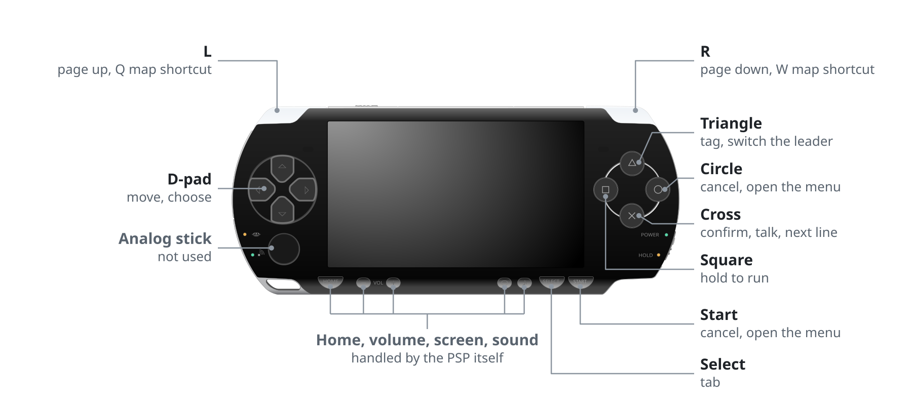
  </picture>
</p>

</details>

<details>
<summary><b>PS Vita</b></summary>
<br>

<p align="center">
  <picture>
    <source media="(prefers-color-scheme: dark)" srcset=".github/controls/vita-light.svg">
    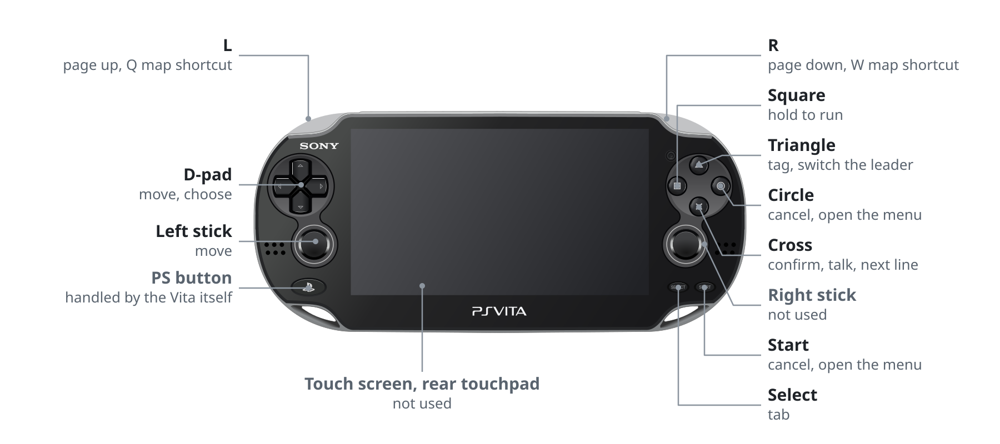
  </picture>
</p>

</details>

<details>
<summary><b>3DS</b></summary>
<br>

<p align="center">
  <picture>
    <source media="(prefers-color-scheme: dark)" srcset=".github/controls/3ds-light.svg">
    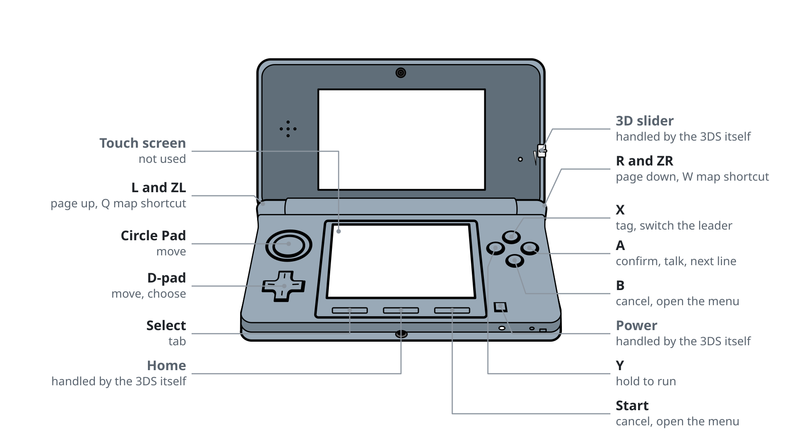
  </picture>
</p>

</details>

<details>
<summary><b>Wii, Wii Remote held sideways</b></summary>
<br>

<p align="center">
  <picture>
    <source media="(prefers-color-scheme: dark)" srcset=".github/controls/wii-remote-light.svg">
    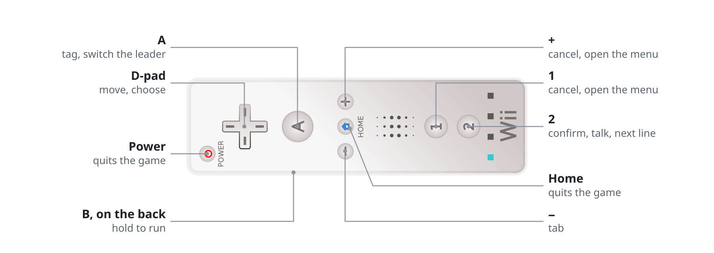
  </picture>
</p>

</details>

<details>
<summary><b>Wii, Classic Controller</b></summary>
<br>

<p align="center">
  <picture>
    <source media="(prefers-color-scheme: dark)" srcset=".github/controls/wii-classic-light.svg">
    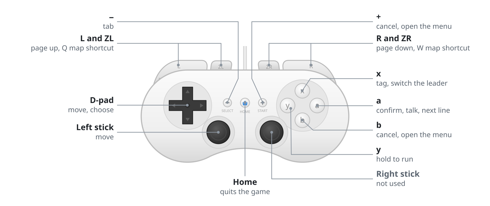
  </picture>
</p>

</details>

<details>
<summary><b>Wii, GameCube controller</b></summary>
<br>

<p align="center">
  <picture>
    <source media="(prefers-color-scheme: dark)" srcset=".github/controls/gamecube-light.svg">
    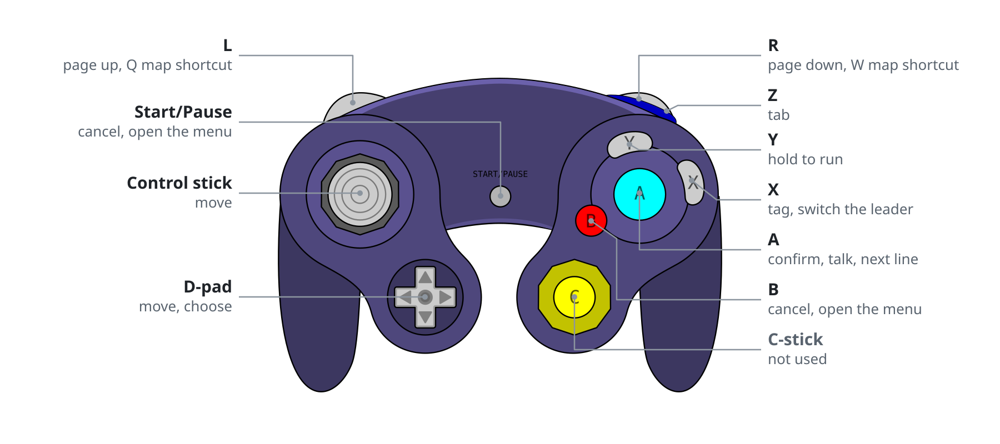
  </picture>
</p>

</details>

<details>
<summary><b>Wii U GamePad</b></summary>
<br>

<p align="center">
  <picture>
    <source media="(prefers-color-scheme: dark)" srcset=".github/controls/wiiu-gamepad-light.svg">
    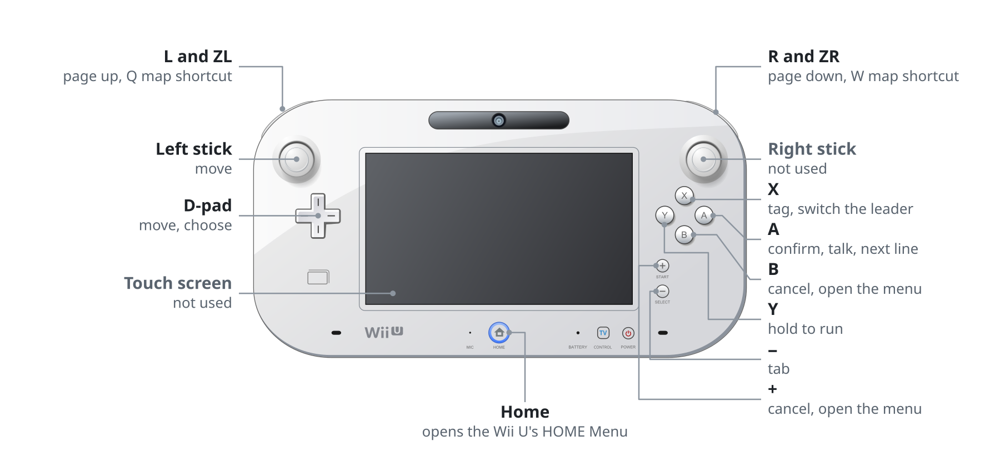
  </picture>
</p>
</details>

<details>
<summary><b>PS3</b></summary>
<br>

<p align="center">
  <picture>
    <source media="(prefers-color-scheme: dark)" srcset=".github/controls/ps3-light.svg">
    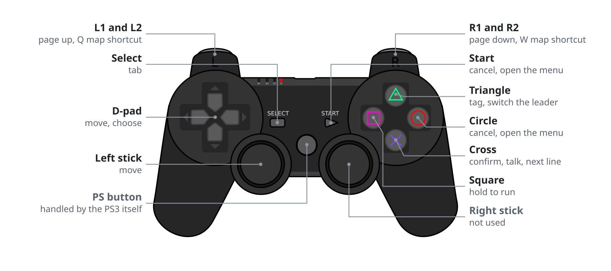
  </picture>
</p>

</details>

<details>
<summary><b>PS2</b></summary>
<br>

<p align="center">
  <picture>
    <source media="(prefers-color-scheme: dark)" srcset=".github/controls/ps2-light.svg">
    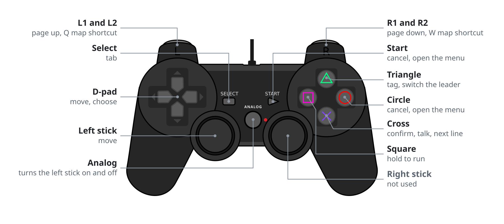
  </picture>
</p>

</details>

<details>
<summary><b>Xbox 360</b></summary>
<br>

<p align="center">
  <picture>
    <source media="(prefers-color-scheme: dark)" srcset=".github/controls/xbox360-light.svg">
    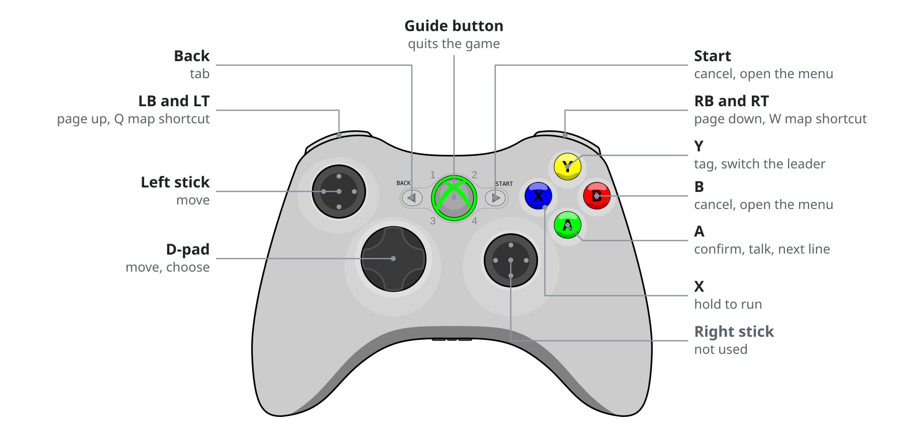
  </picture>
</p>

</details>

| Action | PSP, Vita, PS3, PS2 | Xbox 360 | 3DS | Wii U GamePad, Pro Controller | Wii Remote (sideways) | Classic or GameCube controller |
|---|---|---|---|---|---|---|
| Move | D-pad (left stick on Vita, PS3 and PS2) | D-pad or left stick | D-pad or Circle Pad | D-pad or left stick | D-pad | D-pad or stick |
| Confirm, talk | Cross | A | A | A | 2 | A |
| Cancel | Circle | B | B | B | 1 | B |
| Menu | Start | Start | Start | + | + | + or Start |
| Tag (switch the leader) | Triangle | Y | X | X | A | X |
| Run (hold) | Square | X | Y | Y | B | Y |
| Page up and down, Q and W shortcuts | L and R | LB and RB, or LT and RT | L and R | L and R, or ZL and ZR | | L and R |
| Tab | Select | Back | Select | − | − | − or Z |

## What's different from PC

- **No Steam achievements.**
- **No window shake.** On PC that effect moves the game window around, and a console has no window to move.
- **No keyboard options.** Key rebinding, keyboard prompts, resolution and fullscreen are gone.
- **Picture size follows the console.** The Vita, Wii, Wii U, PS3 and Xbox 360 keep the full 640x480 artwork; the Vita, Wii U, PS3 and Xbox 360 scale
  it up sharply to the height of their screens (the Wii U on the TV and the GamePad at once) and the Wii shows it at its own 640x480. The PSP draws the game at 360x270, the
  3DS at 320x240 on the top screen and the PS2 at 320x240 line-doubled on the TV, with the artwork scaled down to
  match. Movies are converted to fit each console.
- **Sounds can start a beat late** the first time they play in a session, while they're decoded in the background.

## Where it's at

| | PSP | Vita | 3DS | Wii | Wii U | PS3 | PS2 | Xbox 360 |
|---|---|---|---|---|---|---|---|---|
| Builds | Yes | Yes | Yes | Yes | Yes | Yes | Yes | Yes |
| Plays in an emulator | PPSSPP | Vita3K | Azahar | Dolphin | Cemu | RPCS3 | Play! | Untested, because [Xenon](https://github.com/xenon-emu/xenon) is complete shit |
| Real hardware | Runs | Runs | Runs | Runs | Untested | Runs | Runs | Untested |

Every map loads and every enemy group's battle starts on the desktop build, which runs the same engine and data.

## Under the hood

| Folder | What's in it |
|---|---|
| `engine/` | A C++ port of the RPG Maker MV runtime, the plugins and custom systems OMORI uses, and a JavaScript interpreter for the game's scripts. One renderer per console under `engine/src/platform/`: GU on the PSP, GXM on the Vita, citro3d on the 3DS, GX on the Wii, GX2 on the Wii U, RSX on the PS3, the GS on the PS2 and Xenos on the Xbox 360, plus SDL2 with a software renderer for testing on the desktop. |
| `tools/builder/` | Decrypts your game files, scales and stores the artwork in the layout each console's GPU reads directly, packs maps, events and dialogue, converts the WebM movies, renders the fonts, makes the icons and menu art, and writes the console's own package next to the prebuilt engine. |
| `web/` | The same builder compiled to WebAssembly, with a page around it. |

## Building from source

You need `make`, `cmake`, a C and C++ compiler and `curl`. Each console's toolchain, zig (for `make release`),
wasi-sdk and the tailwindcss cli (both for `make web`) are downloaded into `_deps/` on first use.

```
make engines          # build every console engine (downloads the toolchains the first time)
make psp              # or vita, 3ds, wii, wiiu, ps3, ps2, xbox360: build one engine
make builder          # build the builder for this machine (embeds every engine)
make run              # run the builder (GAME=path/to/game, OUT=folder and TARGET=console are optional)
make test             # run the builder unit tests
make desktop          # desktop test build (needs SDL2, libvorbis, zlib); TARGET picks the console layout, make play runs it
make web              # build the in-browser builder into build/web
make release          # cross-compile the builder for Linux, Windows and macOS
make help             # every target
```

Plain `make` builds every engine and the builder. The Vita, Wii U, PS3 and Xbox 360 shaders are checked in; `make vita-shaders`,
`make wiiu-shaders`, `make ps3-shaders` and `make xbox360-shaders` rebuild them.

## License

All rights reserved; this is not open source. You may build and run it for your own personal use, but you may not
modify, redistribute or publish it or builds of it. That's only so the port can't be used to pirate the game or to
pass around malware under its name. [LICENSE](LICENSE) has the details and lists the third-party parts with their
own licenses: miniz and fflate (MIT), stb (MIT or public domain), libvpx and Opus (BSD), minimp3 (CC0), the LLVM
compiler-rt soft-float routines (Apache 2.0 with LLVM exceptions), the Noto fallback fonts (SIL Open Font License,
see `tools/builder/third_party/fallback_fonts/OFL.txt`) and the RPG Maker MV corescript (MIT).

OMORI and everything in it (characters, artwork, music, sounds, fonts and writing) is &copy; OMOCAT, LLC, all rights
reserved, and so is the pencil drawing at the top of this page, which is loaded from the game's Steam page. This project is
not affiliated with or endorsed by OMOCAT. Most console drawings in the controls diagrams come from Openclipart and are in
the public domain (CC0): the [PSP-2000 by Todd Partridge](https://openclipart.org/detail/171228/psp-2000-black), the
[3DS by BHSPitMonkey](https://openclipart.org/detail/158047/handheld-3d-game-system), the
[Wii Remote by lexaficus](https://openclipart.org/detail/96367/wiimote), and the
[PS3](https://openclipart.org/detail/25145/playstation3-gamepad), [GameCube](https://openclipart.org/detail/25144/gamecube-gamepad)
and [Xbox 360](https://commons.wikimedia.org/wiki/File:Xbox360_gamepad.svg) controllers by Grumbel, with the PS2
controller adapted from that PS3 drawing. The [PS Vita](https://commons.wikimedia.org/wiki/File:PlayStation_Vita_illustration.svg)
and [Wii U GamePad](https://commons.wikimedia.org/wiki/File:Wii_U_controller_illustration.svg) drawings are by Tokyoship on
Wikimedia Commons under [CC BY 3.0](https://creativecommons.org/licenses/by/3.0/), with the Vita recolored white for the dark theme.

<br>

<p align="center"><sub>made by <a href="https://github.com/meetox80">kotwicha</a></sub></p>
