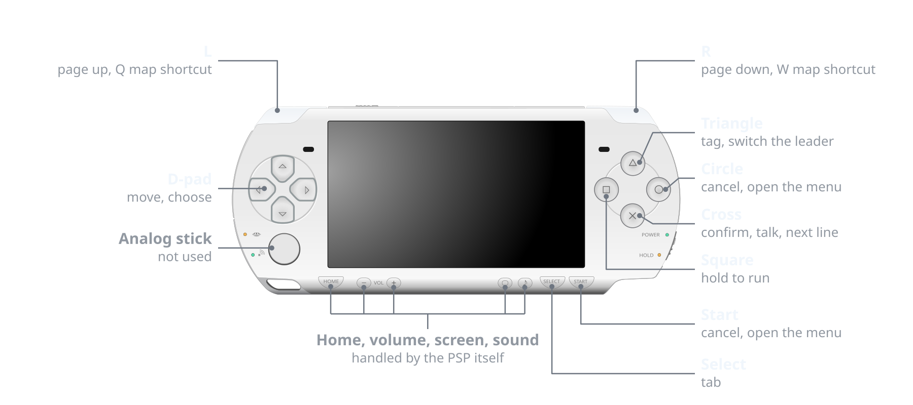

<h1 align="center">OMORI on the PSP</h1>

<p align="center">An unofficial fan port with an engine written from scratch. Bring your own copy of the game and get one EBOOT.PBP for a PSP or PPSSPP.</p>

<p align="center"><a href="https://psp-omori.ox80.cc"><b>Build it in your browser at psp-omori.ox80.cc</b></a></p>

<p align="center">
  <a href="#get-started"><b>Get started</b></a> &nbsp;&nbsp;|&nbsp;&nbsp;
  <a href="#controls"><b>Controls</b></a> &nbsp;&nbsp;|&nbsp;&nbsp;
  <a href="#whats-different-from-pc"><b>What's different</b></a> &nbsp;&nbsp;|&nbsp;&nbsp;
  <a href="#building-from-source"><b>Building from source</b></a>
</p>

<br>

> [!IMPORTANT]
> There is no game content in this repository. Every image, sound and line of dialogue comes from your own copy,
> so the port does nothing without it. [Buy OMORI on Steam](https://store.steampowered.com/app/1150690/OMORI/).

## Get started

**You need** OMORI 1.0.8 from Steam, a PSP-2000, PSP-3000, PSP Go or PSP Street (E1000) with custom firmware (or
PPSSPP), and about 2 GB free on the memory stick.

1. Open [psp-omori.ox80.cc](https://psp-omori.ox80.cc), or build the desktop builder with `make builder`.
2. Give it your game folder (or a .zip of it), the one with `OMORI.exe`, `Launch_OMORI.bat` and `www` in it. On Steam, right-click
   the game, then Manage, then Browse local files.
3. Wait about four minutes.
4. Copy the `PSP` folder it gives you to the root of the memory stick, or open the `EBOOT.PBP` in PPSSPP.

Saves end up in `PSP/GAME/OMORI/saves` and stay there when you update.

> [!NOTE]
> The PSP-1000 can't run it. The EBOOT needs the 64 MB memory mode and the engine keeps a 16 MB image cache, and
> the 1000 only has 32 MB.

<details>
<summary><b>More about the browser builder</b></summary>
<br>

The builder runs at [psp-omori.ox80.cc](https://psp-omori.ox80.cc). Drop in your game folder or a .zip of it, press
Build and download the result. To run the page yourself, `make web-serve` builds it and serves it on
http://localhost:8080.

Everything happens inside your browser and nothing is uploaded. The page needs a current Chrome, Edge, Firefox or Safari (the builder uses WebAssembly
exception handling) and about 4 GB of free disk space, because the browser keeps a copy of the game and writes the
EBOOT to its own storage. The movies are converted on all of your processor's cores at once.

The page ships none of OMORI's files either. Once it has your copy, it dresses itself up with the title screen, a
few White Space sprites, sounds, the game's font and some lines of dialogue, all read from that copy inside your
browser. There are a few things to find on it.

</details>

<details>
<summary><b>More about the desktop builder</b></summary>
<br>

Run it without arguments, or double-click it. It looks for OMORI in your Steam library, asks for the folder if it
can't find it, and then asks where to save. From a terminal:

```
omori-builder path/to/OMORI -o out
```

The game's files are encrypted, and the key comes from `Launch_OMORI.bat` or Steam's launch options. If it can't be
found, pass it with `--key`. `omori-builder --help` lists every option. The builder refuses game versions other
than 1.0.8 and warns when a copy looks cracked.

</details>

## Controls

The buttons follow the game's own gamepad layout.

<p align="center">
  <picture>
    <source media="(prefers-color-scheme: dark)" srcset=".github/controls-light.svg">
    
  </picture>
</p>

## What's different from PC

- **No Steam achievements.**
- **No window shake.** On PC that effect moves the game window around, and a PSP has no window to move.
- **No keyboard options.** Key rebinding, keyboard prompts, resolution and fullscreen are gone.
- **Smaller picture.** The game is drawn at 360x270 in the middle of the 480x272 screen with thin black borders,
  and the builder scales the artwork down to match. Movies are converted to a smaller format and look softer.
- **Sounds can start a beat late** the first time they play in a session, while they're decoded in the background.

## Where it's at

| | State |
|---|---|
| Maps | Every map loads |
| Battles | Every enemy group's battle starts |
| Minigames | All of them play through |
| Real PSP | Runs |

## Under the hood

| Folder | What's in it |
|---|---|
| `engine/` | A C++ port of the RPG Maker MV runtime, the plugins and custom systems OMORI uses, and a JavaScript interpreter for the game's scripts. Runs on the PSP (GU, sceAudio) and on the desktop (SDL2 with a software renderer that matches the PSP output, for testing). |
| `tools/builder/` | Decrypts your game files, scales the 640x480 artwork for the PSP screen, packs maps, events and dialogue, converts the WebM movies, renders the fonts and stores it all in the `EBOOT.PBP` next to the prebuilt engine. |
| `web/` | The same builder compiled to WebAssembly, with a page around it. |

## Building from source

You need `make`, `cmake`, a C and C++ compiler and `curl`. The PSP toolchain, zig (for `make release`), wasi-sdk
and the tailwindcss cli (both for `make web`) are downloaded into `_deps/` on first use.

```
make toolchain        # download the pspdev toolchain
make engine           # build the PSP engine into build/psp/EBOOT.PBP
make builder          # build the builder for this machine (embeds the engine)
make run              # run the builder (GAME=path/to/game and OUT=folder are optional)
make test             # run the builder unit tests
make desktop          # desktop test build (needs SDL2, libvorbis, zlib); make play runs it
make web              # build the in-browser builder into build/web
make release          # cross-compile the builder for Linux, Windows and macOS
make help             # every target
```

Plain `make` builds the engine and the builder.

## License

All rights reserved; this is not open source. You may build and run it for your own personal use, but you may not
modify, redistribute or publish it or builds of it. That's only so the port can't be used to pirate the game or to
pass around malware under its name. [LICENSE](LICENSE) has the details and lists the third-party parts with their
own licenses: miniz and fflate (MIT), stb (MIT or public domain), libvpx and Opus (BSD), minimp3 (CC0), the LLVM
compiler-rt soft-float routines (Apache 2.0 with LLVM exceptions), the Noto fallback fonts (SIL Open Font License,
see `tools/builder/third_party/fallback_fonts/OFL.txt`) and the RPG Maker MV corescript (MIT).

OMORI and everything in it (characters, artwork, music, sounds, fonts and writing) is &copy; OMOCAT, LLC, all rights
reserved, and so is the pencil drawing at the top of this page, which is loaded from the game's Steam page. This project is
not affiliated with or endorsed by OMOCAT. The PSP-2000 drawing in the controls diagram is [by Todd Partridge on Openclipart](https://openclipart.org/detail/171228/psp-2000-black)
and is in the public domain (CC0).

<br>

<p align="center"><sub>made by <a href="https://github.com/meetox80">kotwicha</a></sub></p>
